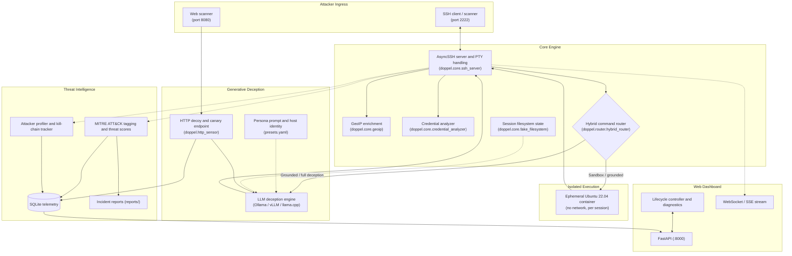
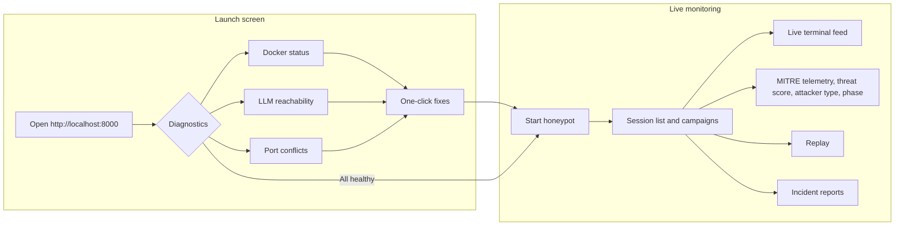

# Doppel: AI-Augmented Hybrid Deception Honeypot System

[](https://www.python.org/downloads/)
[]()
[]()
[]()

**Doppel** is a high-interaction honeypot for observing and profiling attackers. Commands run either in an isolated Docker sandbox or through a generative LLM layer that keeps the system consistent with a chosen server persona. Every session is enriched (GeoIP, credential analysis, MITRE ATT&CK mapping, attacker classification), recorded for replay, correlated into campaigns, and shown live on a web dashboard.

Open work is tracked in [TODO.md](TODO.md).

---

## System Architecture



---

## Command Routing

Every command is classified by `HybridRouter` into one of four routes:

| Route | Used for | How the output is produced |
|---|---|---|
| `BUILTIN` | `cd`, `pwd`, `clear`, `exit`, `logout`, `sudo su`-style elevation | Answered from session state (working directory, effective user) |
| `SANDBOX` | Ordinary commands (`ls`, `cat`, `python3`, …) | Run for real in the session's container |
| `GROUNDED_DECEPTION` | Process, network-interface, mount and memory inspection; sensitive files; credential searches | Run in the container, then rewritten by the model to match the persona and hide container details |
| `LLM_DECEPTION` | Tools the persona lacks (`nmap`, `hydra`, …), network clients and package downloads, login reports (`who`, `w`, `last`), payload downloads piped to a shell, destructive payloads | Generated by the model from the persona prompt |

When Docker is unavailable, everything except built-ins is generated by the model.

Plain pipelines whose first stage is generated (for example `cat .env | grep -i pass | cut -d= -f2`) are split: only the first stage goes to the model, and the remaining text filters (`grep`, `cut`, `awk`, `sort`, `wc`, `base64` and similar) run for real in the sandbox over the generated text, so counts, matches and encodings are exact. Pipelines with chaining, redirection, substitution or a stage that can run commands or write files are routed as a whole.

Plain `whoami`, `id`, `uname` and `hostname` are answered from the persona, because the sandbox shares the host kernel and has its own groups.

Simple identity commands (`whoami`, `id`, `uname`, `hostname`) are answered locally from the active persona's host identity when they contain no shell syntax; anything chained, piped or redirected goes through the normal route instead.

---

## Personas

A persona is one complete machine identity. `active_preset` in `config.yaml` (or the dashboard's persona selector) chooses it, and everything an attacker can observe is taken from it: SSH banner, login banner, shell prompt style, hostname, kernel, account ids, HTTP `Server` header, and the LLM persona prompt.

| Key | Machine |
|---|---|
| `ubuntu_web_server` | Ubuntu 22.04 web/API server (nginx, PHP, MySQL, Node.js) |
| `fintech_api` | Debian 12 payments staging server (FastAPI, PostgreSQL, Redis) |
| `cloud_worker` | Amazon Linux 2023 Kubernetes worker node |

Host identities are defined in `doppel/config/presets.yaml`; persona prompts in `doppel/ai/prompts/deception_prompts.py`. Keep the two in agreement when editing either. The earlier preset names `centos_database` and `debian_cloud_node` still work and map to `fintech_api` and `cloud_worker`.

---

## Features

### Access control and routing

- **Benign command list** (`benign_commands`): common commands that always run in the sandbox when it is available.

### Credential pattern analysis (`doppel/core/credential_analyzer.py`)

Every SSH password attempt is classified before the session starts:

| Label | What it catches |
|---|---|
| `default_credential` | `admin:admin`, `pi:raspberry`, 15 device/service default pairs |
| `same_as_username` | `ubuntu:ubuntu`, `root:root` |
| `common_password` | Built-in top-200 wordlist (extend via `rockyou.txt` path) |
| `hash_pattern` | bcrypt, sha512crypt, MD5, SHA1, SHA256, NTLM in the password field |
| `leaked_credential` | `user:hash` credential-dump format |
| `credential_stuffing` | Email address as username |
| `keyboard_walk` | `qwerty`, `1q2w3e`, `123456`, etc. |
| `empty_password` | Blank field |
| `complex_password` | Long, mixed-case + special char (possible human pen-tester) |

Each analysis emits `risk_level` (`low/medium/high/critical`), `primary_label` and a readable `notes` string. High and critical attempts log a `[CRED ALERT]` warning.

### Session filesystem state (`doppel/core/fake_filesystem.py`)

After each generated command, file operations (redirects, `touch`, `mkdir`, `cp`, `mv`, `rm`, `wget -O`, `curl -o`, `chmod +x`) are tracked per session and fed back into later prompts so files persist across commands.

### HTTP decoy (`doppel/http_sensor/sensor.py`)

Runs on `http_sensor_port` (8080) next to the SSH server and classifies requests into 25 probe types (sensitive files, admin panels, API enumeration, path traversal, SQL and command injection).

- Bait paths get a generated body with a plausible status code. Every other path gets nginx's standard 404 page, without a model call.
- Responses carry the persona's nginx `Server` header and nothing else that identifies the framework (no `/docs`, `/redoc` or `/openapi.json`).
- Requests from one IP on one UTC day are grouped into a single session (`http_<ip>_<yyyymmdd>`), and each request is also written to `web_probes`.

### Canary tokens (`doppel/deception/honeytokens.py`)

Sessions that read sensitive files are issued per-session decoy credentials and verification URLs. The URLs point at `/auth/v1/verify` on the HTTP decoy; presenting an issued token there logs a `honeytoken_activated` probe linked to the original session and raises a dashboard alert. Tokens are stored in the database, so they are still recognised after a restart. Set `deception.canary_base_url` to the decoy's public address so leaked URLs are reachable.

### Port inventory (`doppel/ai/prompts/deception_prompts.py`)

`PERSONA_PORTS` gives each persona an authoritative port list used in every prompt, so `nmap`, `ss`, `netstat` and `lsof -i` agree with each other.

### GeoIP enrichment (`doppel/core/geoip.py`)

Local MaxMind GeoLite2 lookups at connection time (country, city, ASN, datacenter heuristic). Runs without the `.mmdb` files, returning empty fields.

### Attacker classification (`doppel/analytics/profiler.py`)

`AttackerProfiler` runs a five-signal weighted vote per command:

| Signal | Bot evidence | Human evidence |
|---|---|---|
| Median inter-command gap | < 0.5 s | > 3 s |
| Timing regularity (CV) | stdev/mean < 0.15 | High variance |
| Bot-tool invocations | linpeas, nmap, hydra, sqlmap, metasploit, … | — |
| Navigation backtracking | — | ls→cd→ls, repeated pwd |
| Empty submits / Ctrl+C / backspace | — | Human hesitation signals |

It emits `attacker_type` (`bot`, `semi-automated`, `human`, `unknown`) with a confidence score. `tar_pit_delay_ms` is a base delay scaled by attacker type (3× for bots, 1.5× semi-automated, 0.3× humans, with jitter).

### Kill-chain phase tracking (`doppel/analytics/profiler.py`)

Per-command MITRE tactics roll up into a forward-only, 10-phase kill chain:

```
Reconnaissance → Weaponization → Delivery → Exploitation →
Credential Access → Installation → C2 → Lateral Movement →
Exfiltration → Impact
```

Each forward transition is broadcast as a `phase_transition` event and stored in `phase_transitions`.

### Session replay

Every command is stored with the time it was received, the prompt it was typed at (working directory and user) and how long the reply took. The dashboard's Replay tab plays a closed session back with its original pacing (speed control, stepping, optional skipping of pauses over 5 s).

### Campaign correlation

`/api/campaigns` groups sessions that share a source IP, a non-generic username/password pair, or the same opening command sequence. Default and common passwords and short generic command sequences do not link sessions. Campaign IDs stay stable as sessions join, and each campaign lists why its sessions were linked. Web-probe sessions link by IP only.

### Model output safeguards

Model replies are cleaned of markdown fences, reasoning tags and hallucinated prompts, and replies that read like an assistant talking are suppressed. When no believable output can be produced, standard utilities print nothing; only unknown commands get `command not found`.

### Robustness

- Terminal input is processed in chunks with a 64 KB line limit, so oversized input cannot stall other sessions.
- SQLite runs in WAL mode with a 30 s lock timeout, so concurrent sessions do not lose telemetry.
- Incident reports (LLM calls) are limited to `analytics.max_concurrent_reports` at a time.
- Background ATT&CK tagging and session-end reports do not hold up terminal replies. A terminal request interrupts any running analysis call, which goes back to the front of a queue; queued work runs once no terminal request has been made for `analytics.background_idle_seconds` (default 20), or at once from **Run now** in the dashboard's top bar. Tagging runs without the model's reasoning step so it catches up within seconds; reports keep it. A report started with **Regenerate** runs straight away, outside the queue.

---

## Repository Layout

```
Doppel/
├── doppel/
│   ├── ai/
│   │   ├── deception_engine.py      # Prompting, local identity answers, output cleaning
│   │   ├── llm_client.py            # Async OpenAI-compatible client + mock mode
│   │   └── prompts/
│   │       ├── deception_prompts.py # Persona prompts + PERSONA_PORTS
│   │       └── threat_prompts.py    # MITRE analysis and incident report prompts
│   ├── alerts/
│   │   └── email.py                 # Threshold-based email alerts
│   ├── analytics/
│   │   ├── db.py                    # Async SQLite telemetry, replay, campaigns
│   │   ├── observer.py              # MITRE ATT&CK tagging and threat scores
│   │   ├── profiler.py              # Attacker classification + kill-chain tracking
│   │   └── reporter.py              # Markdown incident reports
│   ├── config/
│   │   └── presets.yaml             # Host identity per persona
│   ├── core/
│   │   ├── credential_analyzer.py
│   │   ├── fake_filesystem.py
│   │   ├── geoip.py
│   │   ├── session_manager.py       # Session lifecycle, routing, built-ins
│   │   └── ssh_server.py            # AsyncSSH server, terminal input, banners
│   ├── dashboard/
│   │   ├── app.py                   # FastAPI endpoints, WebSocket/SSE
│   │   ├── controller.py            # Honeypot lifecycle, HTTP decoy, diagnostics
│   │   ├── ip_filter.py             # Dashboard IP allowlist
│   │   └── static/                  # Dashboard UI
│   ├── deception/
│   │   └── honeytokens.py           # Canary token issue and verification
│   ├── http_sensor/
│   │   └── sensor.py                # HTTP decoy and canary endpoint
│   ├── router/
│   │   └── hybrid_router.py         # Route classification
│   ├── sandbox/
│   │   ├── Dockerfile               # Ubuntu 22.04 sandbox image
│   │   └── docker_manager.py        # Container lifecycle
│   ├── cli.py                       # CLI entry point
│   └── config.py                    # Settings model and persona resolution
├── tests/
├── config.yaml
├── docker-compose.yml
├── Dockerfile
├── TODO.md
├── pyproject.toml
└── requirements.txt
```

---

## Web Dashboard

`python -m doppel.cli dashboard` serves the control center on port 8000.



### Dashboard IP allowlist

List the IPs or CIDR ranges allowed to open the dashboard (HTTP, SSE and WebSocket):

```yaml
access:
  dashboard_allowed_ips:
    - "127.0.0.1"
    - "192.168.1.10"
    - "10.0.0.0/24"
```

- Any other address receives `403 Forbidden`.
- An empty list allows loopback only.
- Behind a reverse proxy, configure uvicorn's `--forwarded-allow-ips` so the real client IP is seen.

### Live event stream

| Event | When fired | Key payload fields |
|---|---|---|
| `session_created` | Connection authenticated | `geoip`, `credential_analysis` |
| `command_executed` | Each command processed | `prompt_cwd`, `prompt_user`, `decision`, `attacker_type`, `current_phase` |
| `profile_updated` | After each command | Full `profile` dict |
| `phase_transition` | Kill chain advances | `from_phase`, `to_phase`, `phase_index`, `triggered_by` |
| `threat_analyzed` | MITRE tagging completes | `threat`, `threat_score` |
| `web_probe` | HTTP decoy hit | `probe_label`, `method`, `path`, `status_code` |
| `honeytoken_activated` | Canary token presented | `token_type`, `session_id`, `remote_ip` |
| `session_closed` | Session ends | `report_path` |

---

## Quick Start

### 1. Dashboard (recommended)

```bash
git clone https://github.com/Cosmic-Infinity/Doppel.git
cd Doppel
pip install -r requirements.txt
python -m doppel.cli dashboard --host 0.0.0.0 --port 8000
```

Open `http://localhost:8000`, review the diagnostics and select **Start Honeypot**.

### 2. Headless

```bash
python -m doppel.cli run
```

Starts the SSH listener and HTTP decoy without the dashboard.

### 3. Docker Compose

```bash
docker compose up -d --build
```

Publishes SSH on 2222 and the HTTP decoy on 8080, and keeps the database and SSH host keys in `./data` so the server's fingerprint survives redeploys. See the comments in `docker-compose.yml` for running the dashboard inside the container.

### 4. Sandbox image

The sandbox uses a local Ubuntu 22.04 image built from `doppel/sandbox/Dockerfile`. It is built automatically on first use (sessions use simulated execution until it is ready), or ahead of time:

```bash
python -m doppel.cli build-sandbox
```

### 5. Local simulator

```bash
python -m doppel.cli sim
```

Runs a session in the terminal without SSH, useful for checking persona output.

### 6. Remote GPU over Tailscale

```bash
# On the GPU machine
OLLAMA_HOST=0.0.0.0:11434 ollama serve
ollama pull qwen2.5-coder:7b
```

```bash
# In .env
DOPPEL_LLM__BASE_URL=http://<tailscale-ip>:11434/v1
DOPPEL_LLM__MODEL=qwen2.5-coder:7b
```

```bash
python -m doppel.cli test-model
python -m doppel.cli dashboard --port 8000
```

### 7. GeoIP (optional)

1. Register at [maxmind.com](https://www.maxmind.com/en/geolite2/signup) (free).
2. Download `GeoLite2-City.mmdb` and `GeoLite2-ASN.mmdb`.
3. Set the paths in `config.yaml`:

```yaml
geoip:
  city_db_path: "/opt/geoip/GeoLite2-City.mmdb"
  asn_db_path:  "/opt/geoip/GeoLite2-ASN.mmdb"
```

---

## Configuration (`config.yaml`)

Main settings (see `config.yaml` for the full file and `doppel/config.py` for defaults):

```yaml
active_preset: "ubuntu_web_server"   # ubuntu_web_server | fintech_api | cloud_worker

honeypot:
  host: "0.0.0.0"
  port: 2222
  server_banner: "SSH-2.0-OpenSSH_8.9p1 Ubuntu-3ubuntu0.6"  # used if the persona defines none
  accept_any_password: true
  host_key_dir: "."                   # keep on persistent storage

llm:
  base_url: "http://127.0.0.1:11434/v1"
  model: "qwen2.5-coder:7b"
  timeout_seconds: 45.0
  mock_mode: false
  analysis_model: ""                  # ATT&CK tagging and reports; empty = same as model
  analysis_timeout_seconds: 120.0     # background analysis may wait longer than the terminal

deception:
  tar_pit_delay_ms: 0
  intercept_sensitive_files: true
  intercept_missing_tools: true
  dynamic_honeytokens: true
  canary_base_url: ""                 # public address of the HTTP decoy

sandbox:
  enabled: true
  image: "doppel-sandbox:ubuntu-22.04"
  network_disabled: true
  memory_limit: "256m"

analytics:
  db_path: "doppel_telemetry.db"
  enable_mitre_tagging: true
  reports_dir: "reports"
  max_concurrent_reports: 2
  background_idle_seconds: 20         # analysis waits this long after the last terminal request

access:
  dashboard_allowed_ips: ["127.0.0.1"]

http_sensor_port: 8080                # 0 disables the HTTP decoy
```

### Environment variable overrides

Environment variables override `config.yaml`. Nested settings use a double underscore: `DOPPEL_<SECTION>__<KEY>`. Top-level settings use a single one. See `.env.example`.

| Variable | Setting |
|---|---|
| `DOPPEL_ACTIVE_PRESET` | `active_preset` |
| `DOPPEL_HONEYPOT__HOST` / `DOPPEL_HONEYPOT__PORT` | `honeypot.host` / `honeypot.port` |
| `DOPPEL_HONEYPOT__HOST_KEY_DIR` | `honeypot.host_key_dir` |
| `DOPPEL_LLM__BASE_URL` / `DOPPEL_LLM__MODEL` | `llm.base_url` / `llm.model` |
| `DOPPEL_LLM__TIMEOUT_SECONDS` | `llm.timeout_seconds` |
| `DOPPEL_LLM__MOCK_MODE` | `llm.mock_mode` |
| `DOPPEL_DECEPTION__CANARY_BASE_URL` | `deception.canary_base_url` |
| `DOPPEL_SANDBOX__ENABLED` / `DOPPEL_SANDBOX__IMAGE` | `sandbox.enabled` / `sandbox.image` |
| `DOPPEL_ANALYTICS__DB_PATH` | `analytics.db_path` |
| `DOPPEL_HTTP_SENSOR_PORT` | `http_sensor_port` |
| `DOPPEL_GEOIP__CITY_DB_PATH` / `DOPPEL_GEOIP__ASN_DB_PATH` | GeoIP database paths |

---

## Database Schema

SQLite (`doppel_telemetry.db`, WAL mode). Columns added in newer versions are migrated automatically on startup.

**`sessions`**: one row per SSH session, or per IP per day for web probes.

| Column | Description |
|---|---|
| `session_id` | UUID, or `http_<ip>_<yyyymmdd>` for web probes |
| `remote_ip`, `remote_port` | Source address |
| `username`, `password` | Credentials used |
| `start_time`, `end_time` | ISO-8601 timestamps |
| `max_threat_score` | Highest per-command score (0–100) |
| `country_code`, `country_name`, `city`, `asn`, `asn_org`, `is_datacenter` | GeoIP |
| `attacker_type`, `type_confidence`, `current_phase` | Profiler output |
| `credential_risk` | `low` / `medium` / `high` / `critical` |
| `campaign_id`, `campaign_reasons` | Campaign correlation |
| `summary` | LLM incident summary |

**`commands`**: one row per command.

| Column | Description |
|---|---|
| `session_id` | Session reference |
| `timestamp` | When the command was received |
| `cwd`, `prompt_user` | Directory and user shown in the prompt it was typed at |
| `command`, `output` | Command and reply |
| `duration_ms` | Time until the reply appeared |
| `route_decision` | `builtin` / `sandbox` / `grounded_deception` / `llm_deception` / `http_sensor` |
| `technique_id`, `technique_name`, `tactics`, `threat_score` | MITRE ATT&CK |
| `reasoning` | Model reasoning, shown on the dashboard only |

**`phase_transitions`**: one row per forward kill-chain transition (`from_phase`, `to_phase`, `phase_index`, `triggered_by`).

**`web_probes`**: one row per HTTP decoy request (`method`, `path`, `query`, `user_agent`, `probe_label`, `status_code`, `response_snippet`).

**`honeytokens`**: issued canary tokens (`identifier`, `token_type`, `session_id`, `canary_url`, `created_at`).

---

## Testing

```bash
python -m pytest
```

- `tests/test_router.py`: route classification, benign passthrough, safe-IP mode.
- `tests/test_llm_client.py`: client, streaming and mock responses.
- `tests/test_session.py`: session lifecycle, built-ins, logging, schema migration.
- `tests/test_dashboard.py`: diagnostics, quick fixes, config endpoints.
- `tests/test_replay_campaigns.py`: replay timing and campaign correlation.
- `tests/test_hardening.py`: terminal input handling, local identity answers, HTTP decoy, canary endpoint, concurrent telemetry writes.

---

## Telemetry and Reports

- **Dashboard**: `http://localhost:8000`, live over WebSocket with SSE fallback.
- **Database**: `doppel_telemetry.db`, readable with any SQLite client.
- **Incident reports**: generated when a session closes, in `reports/incident_<id>_<ts>.md`.
- **Manual report**:
  ```bash
  python -m doppel.cli report <session_id>
  ```
