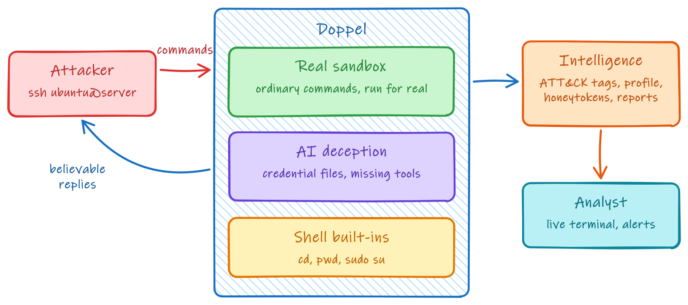
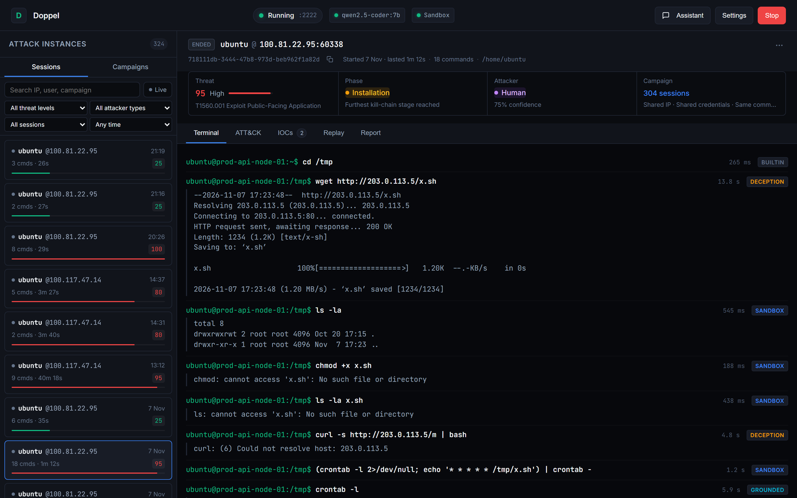

# Doppel: AI-Augmented Hybrid Honeypot System

Doppel is an SSH honeypot that answers attackers with a mix of real execution and language-model output. Ordinary commands run in a disposable, network-isolated Docker container; commands whose real output would give the container away are run and then rewritten by a model; commands the container cannot answer believably are generated from a persona that describes one complete server. Every session becomes threat intelligence: credential analysis, MITRE ATT&CK tags, attacker profiling, kill-chain tracking, per-session honeytokens, campaigns and incident reports, all on a live web dashboard with replay.



## How it works

| Route | Used for | Output |
|---|---|---|
| Built-in | `cd`, `pwd`, `exit`, `sudo su` | From session state |
| Sandbox | Ordinary commands | Real execution in the container |
| Grounded | Process, mount and network listings; container files | Real execution, rewritten to match the persona |
| Generated | Attack tools, network clients, credential files | Generated by the model |

An HTTP decoy on port 8080 catches web scanning and verifies stolen honeytokens.

## Quick start

```bash
git clone https://github.com/Cosmic-Infinity/Doppel.git
cd Doppel
pip install -r requirements.txt
python -m doppel.cli dashboard --host 0.0.0.0 --port 8000
```

Open `http://localhost:8000`, review the diagnostics and select **Start Honeypot**. Attackers connect over SSH on port 2222.



Doppel needs Docker for the sandbox and an OpenAI-compatible model server (for example Ollama with `qwen2.5-coder:7b`). Without them it still runs: commands are generated instead of executed, and `llm.mock_mode: true` replaces the model with deterministic replies.

## Documentation

- [Architecture](docs/architecture.md): components, command routing, personas, repository layout
- [Features](docs/features.md): consistency, safeguards, HTTP decoy, honeytokens, threat analysis
- [Dashboard and control API](docs/dashboard.md): views, IP allowlist, live events, REST endpoints
- [Setup and configuration](docs/setup.md): run modes, Docker, remote model, GeoIP, `config.yaml`, data

## Testing

```bash
python -m pytest
```

The suite runs without a GPU or Docker, using the model client's mock mode and mocked containers.

Open work is tracked in [TODO.md](TODO.md).
