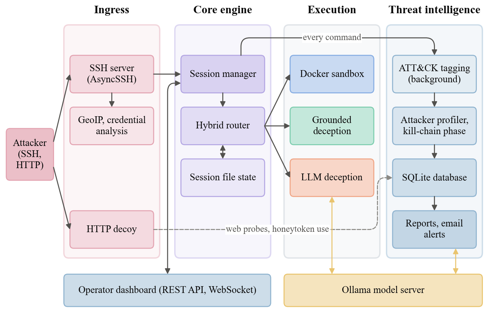
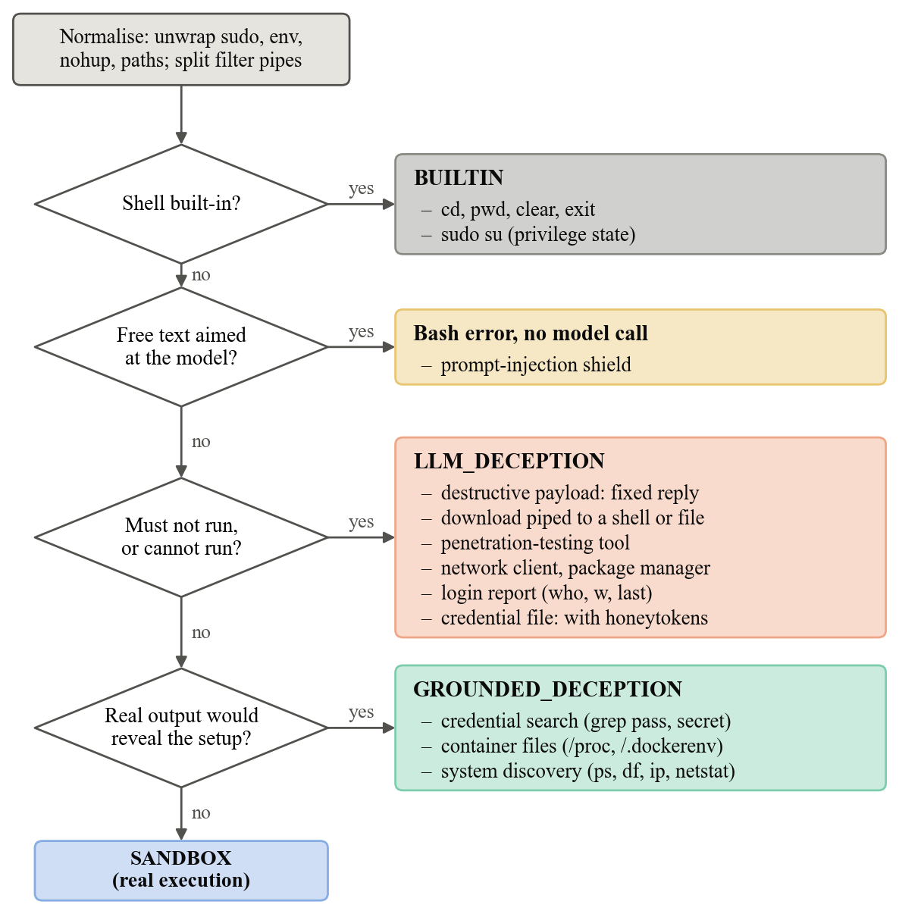

# Architecture

## Components



- **Ingress**: the SSH server (port 2222) and the HTTP decoy (port 8080).
- **Core engine**: the session manager holds each session's state and runs every command through the hybrid router; GeoIP and credential analysis happen at connection and login.
- **Execution**: the sandbox container, the deception engine (persona prompt, session file state, honeytokens, output cleaning) or both.
- **Threat intelligence**: ATT&CK tagging, profiling and reports run in the background and are stored in SQLite.
- **Dashboard**: a FastAPI app with a REST API and a live event stream.

## Command routing

`HybridRouter` sends every command to one of four routes:

| Route | Used for | How the output is produced |
|---|---|---|
| `BUILTIN` | `cd`, `pwd`, `clear`, `exit`, `logout`, `sudo su`-style elevation | From session state (working directory, effective user) |
| `SANDBOX` | Ordinary commands (`ls`, `cat`, `python3`, ...) | Run for real in the session's container |
| `GROUNDED_DECEPTION` | Process, interface, mount and memory listings; container-revealing files; credential searches | Run in the container, then rewritten by the model to match the persona and hide container details |
| `LLM_DECEPTION` | Tools the persona lacks (`nmap`, `hydra`, ...), network clients and package managers, login reports (`who`, `w`, `last`), credential files, downloads piped to a shell, destructive payloads | Generated by the model from the persona prompt (destructive payloads get a fixed reply) |



When Docker is unavailable, everything except built-ins is generated by the model.

Plain identity commands (`whoami`, `id`, `uname`, `hostname`, `cat /proc/version`) are answered from the persona's host identity when they contain no shell syntax, because the sandbox shares the host kernel and has its own groups.

Pipelines whose first stage is generated (for example `cat .env | grep -i pass | cut -d= -f2`) are split: only the first stage goes to the model, and the text filters after it (`grep`, `cut`, `awk`, `sort`, `wc`, `base64` and similar) run for real in the sandbox over the generated text. Pipelines with chaining, redirection, substitution or a stage that can run commands or write files are routed as a whole.

## Personas

A persona is one complete machine identity. `active_preset` in `config.yaml`, or the persona list on the dashboard's setup screen, chooses it. Everything an attacker can observe comes from it: SSH banner, login message, prompt style, hostname, kernel, account ids, HTTP `Server` header and the model's persona prompt. The sandbox container takes the persona's hostname, login user, home directory and OS release.

| Key | Machine |
|---|---|
| `ubuntu_web_server` | Ubuntu 22.04 web/API server (nginx, PHP, MySQL, Node.js) |
| `fintech_api` | Debian 12 payments staging server (FastAPI, PostgreSQL, Redis) |
| `cloud_worker` | Amazon Linux 2023 Kubernetes worker node |

Host identities live in `doppel/config/presets.yaml` and persona prompts in `doppel/ai/prompts/deception_prompts.py`; keep the two in agreement when editing either. The older preset names `centos_database` and `debian_cloud_node` still work and map to `fintech_api` and `cloud_worker`.

## Repository layout

```
Doppel/
├── doppel/
│   ├── ai/
│   │   ├── background_queue.py      # Analysis queue that gives way to terminal replies
│   │   ├── deception_engine.py      # Prompting, identity answers, output cleaning
│   │   ├── llm_client.py            # Async OpenAI-compatible client and mock mode
│   │   ├── mock_analysis.py         # Rule-based tags and assistant answers in mock mode
│   │   ├── prompt_shield.py         # Prompt-injection detection
│   │   └── prompts/
│   │       ├── deception_prompts.py # Persona prompts and PERSONA_PORTS
│   │       └── threat_prompts.py    # ATT&CK analysis and incident report prompts
│   ├── alerts/email.py              # Threshold-based email alerts
│   ├── analytics/
│   │   ├── db.py                    # Async SQLite telemetry, replay, campaigns
│   │   ├── ioc.py                   # Indicators of compromise from commands
│   │   ├── observer.py              # ATT&CK tagging and threat scores
│   │   ├── profiler.py              # Attacker classification and kill-chain tracking
│   │   └── reporter.py              # Markdown incident reports
│   ├── config/presets.yaml          # Host identity per persona
│   ├── core/
│   │   ├── clock.py                 # Simulated clock (boot time, uptime, logins)
│   │   ├── credential_analyzer.py
│   │   ├── entity_cache.py          # Values and IPs that generated output introduced
│   │   ├── fake_filesystem.py       # Files created or read in the session
│   │   ├── geoip.py
│   │   ├── session_manager.py       # Session lifecycle, routing, built-ins, latency
│   │   └── ssh_server.py            # AsyncSSH server, terminal input, banners
│   ├── dashboard/
│   │   ├── app.py                   # FastAPI endpoints, WebSocket and SSE
│   │   ├── controller.py            # Honeypot lifecycle, HTTP decoy, diagnostics, settings
│   │   ├── ip_filter.py             # Dashboard IP allowlist
│   │   └── static/                  # Dashboard UI
│   ├── deception/honeytokens.py     # Per-session decoy credentials and verification
│   ├── http_sensor/sensor.py        # HTTP decoy and canary endpoint
│   ├── router/hybrid_router.py      # Route classification
│   ├── sandbox/
│   │   ├── Dockerfile               # Ubuntu 22.04 sandbox image
│   │   └── docker_manager.py        # Container lifecycle and limits
│   ├── cli.py                       # CLI entry point
│   └── config.py                    # Settings model and persona resolution
├── docs/
├── tests/
├── config.yaml
├── docker-compose.yml
└── pyproject.toml
```
