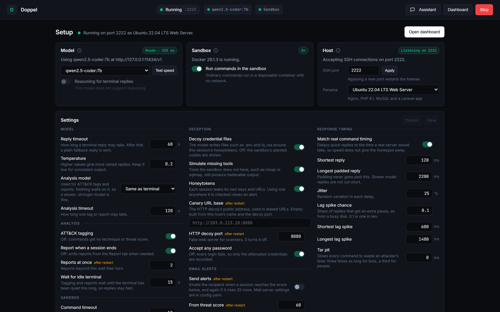

# Dashboard and control API

`python -m doppel.cli dashboard` serves the dashboard on port 8000.

- **Setup screen**: diagnostics (Docker, model endpoint and model, reasoning support, port conflicts) with one-click fixes, the persona list, and the settings exposed by the control API. Settings that apply only after a restart are marked.
- **Header**: honeypot state and port, model and sandbox health, and the analysis queue.
- **Sessions**: search by IP, user or campaign; filter by threat level, attacker type, campaign and date, or show live sessions only.
- **Session views**: Terminal (commands, routes, timing and model reasoning), ATT&CK, IOCs, Replay (original pacing, speed control, stepping) and Report (streamed while it is written; copy or export as PDF).
- **Campaigns**: linked sessions and the reasons they were linked.
- **Assistant**: answers questions about current activity from a model of the operator's choice.



## IP allowlist

List the addresses or CIDR ranges allowed to open the dashboard (HTTP, SSE and WebSocket):

```yaml
access:
  dashboard_allowed_ips:
    - "127.0.0.1"
    - "10.0.0.0/24"
```

Any other address receives `403 Forbidden`, and an empty list allows loopback only. Behind a reverse proxy, set uvicorn's `--forwarded-allow-ips` so the real client address is seen.

## Live events

Events arrive over `WS /ws/stream`, with `GET /api/stream` (SSE) as a fallback.

| Event | When | Key fields |
|---|---|---|
| `session_created` | Login accepted | `geoip`, `credential_analysis` |
| `command_executed` | Each command answered | `prompt_cwd`, `prompt_user`, `decision`, `attacker_type`, `current_phase` |
| `profile_updated` | After each command | `profile` |
| `phase_transition` | Kill chain advances | `from_phase`, `to_phase`, `phase_index`, `triggered_by` |
| `threat_analyzed` | ATT&CK tagging done | `threat`, `threat_score` |
| `web_probe` | HTTP decoy request | `probe_label`, `method`, `path`, `status_code` |
| `honeytoken_activated` | Canary token presented | `token_type`, `session_id`, `remote_ip` |
| `report_progress` | Report being written | `stage`, `delta` |
| `background_queue` | Analysis queue changes | queued and running jobs |
| `session_closed` | Session ended | `report_path` |

## Control API

Everything the dashboard does goes through a REST API, so Doppel can be scripted. Interactive documentation is at `/docs` and the schema at `/openapi.json`, behind the same allowlist.

| Endpoint | Purpose |
|---|---|
| `GET /api/status`, `GET /api/diagnostics` | State, active settings, analysis queue, environment checks |
| `POST /api/start`, `POST /api/stop` | Start or stop the honeypot |
| `GET /api/settings`, `PATCH /api/settings` | Read or change settings |
| `POST /api/quick-fix` | `set_model`, `set_terminal_reasoning`, `set_auto_reports`, `toggle_sandbox`, `recheck` |
| `POST /api/background/run-now` | Run queued analysis now |
| `GET /api/sessions`, `GET` or `DELETE /api/sessions/{id}` | Sessions with commands, tags and profile |
| `GET /api/sessions/{id}/replay` | Timed replay frames |
| `GET /api/sessions/{id}/iocs` | Indicators of compromise |
| `GET /api/sessions/{id}/report`, `POST .../report/stream`, `POST .../report/stop` | Read, generate or stop a report |
| `GET /api/campaigns`, `GET /api/campaigns/{id}` | Campaigns and why sessions were linked |
| `POST /api/chat-assistant` (and `/stream`, `/stop`) | Ask the assistant |

`PATCH /api/settings` takes any subset of the settings returned by `GET /api/settings`, nested by section:

```bash
curl -X PATCH http://localhost:8000/api/settings -H "Content-Type: application/json" \
     -d '{"llm": {"timeout_seconds": 60}, "analytics": {"auto_reports": false}}'
```

Values are validated and applied together, or not at all (`422` with the reason). Most apply immediately; the response lists under `applies_on_next_start` those that take effect after a Stop and Start (ports, SSH banner, sandbox limits, report concurrency, canary URL, email alerts). Changes last until the dashboard restarts; `config.yaml` is not rewritten. API keys, SMTP credentials, file paths, bind addresses, the allowlist and sandbox network isolation cannot be changed through the API.
