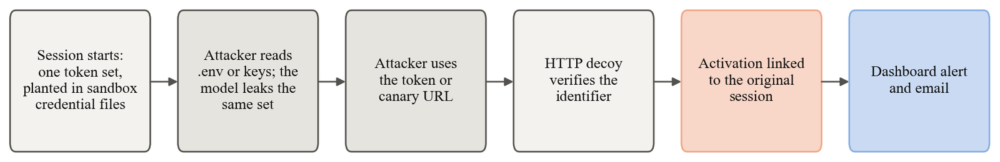
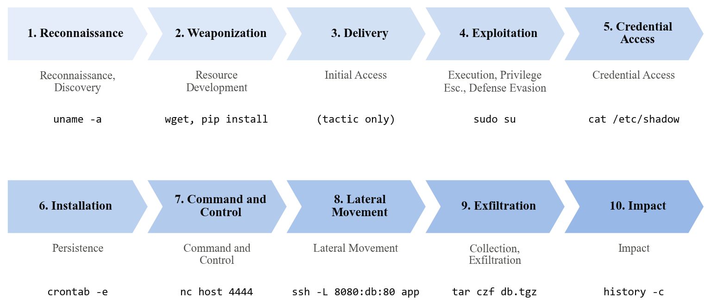

# Features

## Credential analysis

`doppel/core/credential_analyzer.py` classifies every SSH password attempt before the session starts:

| Label | What it catches |
|---|---|
| `default_credential` | `admin:admin`, `pi:raspberry` and other device or service defaults |
| `same_as_username` | `ubuntu:ubuntu`, `root:root` |
| `common_password` | Built-in top-200 list (extendable with a wordlist such as `rockyou.txt`) |
| `hash_pattern` | bcrypt, sha512crypt, MD5, SHA-1, SHA-256 or NTLM hash in the password field |
| `leaked_credential` | `user:hash` credential-dump format |
| `credential_stuffing` | E-mail address as the username |
| `keyboard_walk` | `qwerty`, `1q2w3e`, `123456` and similar |
| `empty_password` | Blank password |
| `complex_password` | Long, mixed-case password with symbols (possibly a human tester) |

Each analysis gives a `risk_level` (`low` to `critical`), a `primary_label` and a short note. High and critical attempts log a `[CRED ALERT]` warning.

## Consistency across commands

- **Session file state** (`doppel/core/fake_filesystem.py`): file operations in generated output (redirects, `touch`, `mkdir`, `cp`, `mv`, `rm`, `wget -O`, `curl -o`, `chmod +x`) are tracked and fed into later prompts. Generated credential files are stored, so later reads return the same content.
- **Entity cache** (`doppel/core/entity_cache.py`): settings written as `KEY=VALUE` and private IP addresses in model replies are kept (up to 32 of each) and given to later prompts as facts not to contradict.
- **Port inventory** (`PERSONA_PORTS`): each persona has an authoritative port list used in every prompt, so `nmap`, `ss`, `netstat` and `lsof -i` agree.
- **Simulated clock** (`doppel/core/clock.py`): boot time, uptime and login times agree across `date`, `uptime`, `w`, `last` and log timestamps.

## Model output safeguards

Replies are cleaned of Markdown fences, reasoning tags, echoed commands and hallucinated prompts, and replies written in an assistant's voice are suppressed. Prompt-injection attempts never reach the model (`doppel/ai/prompt_shield.py`). When no believable output can be produced, standard utilities print nothing and only unknown commands get `command not found`.

## Response timing

Real execution returns in milliseconds while the model takes seconds, so every reply is held until a target time chosen for its kind of command, with jitter and occasional stalls. The ordinary delay is bounded by `deception.min_latency_ms` and `deception.max_latency_ms` (120 ms and 2.2 s by default). An optional tar pit (`tar_pit_delay_ms`) adds a delay scaled by attacker type (3x for bots, 1.5x semi-automated, 0.3x humans).

## HTTP decoy

`doppel/http_sensor/sensor.py` runs on `http_sensor_port` (8080) and classifies requests into about 25 probe types (sensitive files, admin panels, API enumeration, path traversal, SQL and command injection).

- Bait paths get a generated body with a plausible status code; every other path gets nginx's standard 404 page without a model call.
- Responses carry the persona's nginx `Server` header and expose none of the framework's own endpoints.
- Requests from one IP on one UTC day form one session (`http_<ip>_<yyyymmdd>`), and each request is also stored in `web_probes`.

## Honeytokens

Each session gets one set of decoy credentials (an AWS-style key pair, an API key and a webhook token), each with a canary URL on the decoy's `/auth/v1/verify` endpoint. For the Ubuntu persona the set is planted in the container's `.env` and `~/.aws/credentials` at login; generated credential files leak the same set. Presenting a token at the endpoint logs a `honeytoken_activated` probe linked to the original session and raises a dashboard alert. The use is added to the incident reports of the session that leaked the token, even ones already written; both sessions link to each other in the dashboard and join the same campaign. Tokens are stored in the database, so they are still recognised after a restart. Set `deception.canary_base_url` to the decoy's public address so leaked URLs are reachable.

## Threat analysis

- **ATT&CK tagging** (`doppel/analytics/observer.py`): common reconnaissance commands and prompt-injection attempts (MITRE ATLAS) are tagged from rules; other commands are tagged by the model in the background, with a 0-100 threat score.
- **Indicators of compromise** (`doppel/analytics/ioc.py`): URLs, IP addresses and domains in the session's commands.
- **GeoIP** (`doppel/core/geoip.py`): country, city, ASN and a datacenter flag from local MaxMind GeoLite2 files; without the files, the fields are empty.
- **Attacker classification** (`doppel/analytics/profiler.py`): a weighted vote over six signals labels the attacker `bot`, `semi-automated`, `human` or `unknown`, with a confidence:

  | Signal | Bot evidence | Human evidence |
  |---|---|---|
  | Median gap between commands | < 0.5 s | > 3 s |
  | Timing regularity (coefficient of variation) | < 0.15 | >= 0.5 |
  | Attack-tool use | linpeas, nmap, hydra, sqlmap, ... | |
  | Navigation backtracking | | ls, cd, ls; repeated pwd |
  | Hesitation | | Empty submits, Ctrl+C, backspace |
  | Keystroke dynamics | Paste-like bursts | Irregular gaps |

- **Kill-chain tracking**: per-command tactics roll up into a forward-only, ten-phase kill chain (Reconnaissance, Weaponization, Delivery, Exploitation, Credential Access, Installation, Command and Control, Lateral Movement, Exfiltration, Impact). Each forward step is broadcast as `phase_transition` and stored.

  
- **Campaign correlation**: sessions that share a source IP, a non-generic username and password, or the same opening commands are grouped; default credentials and short generic sequences do not link sessions. Campaign IDs stay stable as sessions join, and each campaign lists why its sessions were linked.
- **Incident reports**: when a session closes, a Markdown report (summary, attacker profile, ATT&CK summary, timeline, indicators, recommendations) is generated in the background, streamed to the dashboard and saved to `reports/`. Reports can be exported as PDF from the dashboard.
- **Email alerts** (`doppel/alerts/email.py`): sent over SMTP when a session's threat score reaches a threshold.

## Background analysis

A local inference server answers one request at a time, so tagging and report calls go through a queue that gives way to the terminal. A terminal request interrupts the running analysis call, which returns to the front of the queue; queued work runs once the terminal has been idle for `analytics.background_idle_seconds` (20 by default), or at once from **Run now** on the dashboard. Tags run before reports.

## Mock mode

With `llm.mock_mode`, no model is needed: commands get deterministic replies, ATT&CK tags come from a rule book of about 25 command patterns, and the analyst assistant answers from the recorded sessions. The automated tests use it.

## Robustness

- Terminal input is processed in chunks with a 64 KB line limit, so oversized input cannot stall other sessions.
- SQLite runs in WAL mode with a 30 s lock timeout, so concurrent sessions do not lose telemetry.
- Sandbox containers run with no network, a memory limit and a CPU quota, and are removed when the session ends.
- If the model fails or times out, a plausible fixed reply is used; if Docker is unavailable, commands are generated instead.
