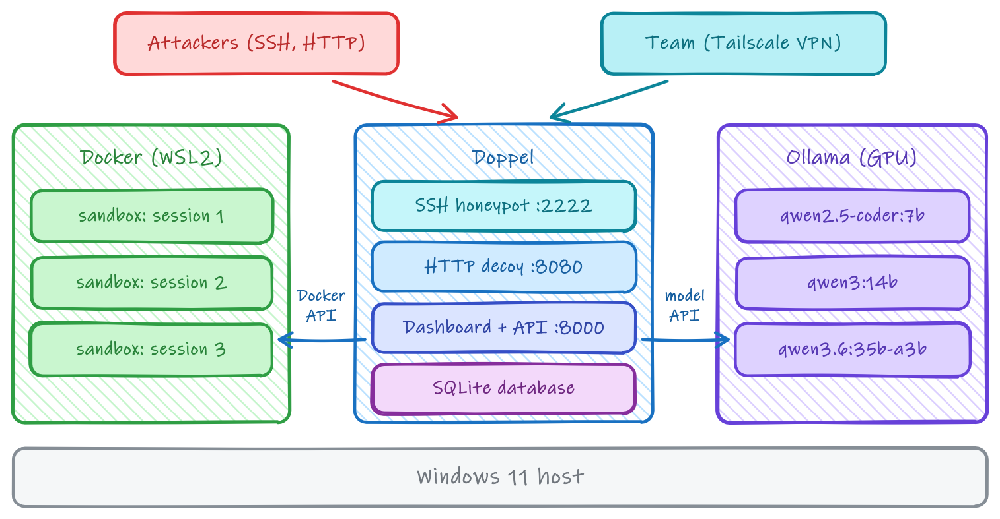

# Setup and configuration

## Running Doppel

| Command | What it does |
|---|---|
| `python -m doppel.cli dashboard --host 0.0.0.0 --port 8000` | Dashboard; start the honeypot from the setup screen |
| `python -m doppel.cli run` | SSH listener and HTTP decoy without the dashboard |
| `python -m doppel.cli sim` | A session in the local terminal, without SSH, for checking persona output |
| `python -m doppel.cli test-model` | Check that the configured model answers |
| `python -m doppel.cli build-sandbox` | Build the sandbox image ahead of time |
| `python -m doppel.cli report <session_id>` | Write an incident report for a session |

### Docker Compose

```bash
docker compose up -d --build
```

Publishes SSH on 2222 and the HTTP decoy on 8080, and keeps the database and SSH host keys in `./data`, so the server's fingerprint survives redeploys. See the comments in `docker-compose.yml` for running the dashboard inside the container.

### Sandbox image

The sandbox uses a local Ubuntu 22.04 image built from `doppel/sandbox/Dockerfile`. It is built automatically on first use (sessions use generated output until it is ready), or ahead of time with `build-sandbox`.

### Model on another machine

Any OpenAI-compatible server works (Ollama, vLLM, llama.cpp). For Ollama on a GPU machine reachable over a private network such as Tailscale:

```bash
# On the GPU machine
OLLAMA_HOST=0.0.0.0:11434 ollama serve
ollama pull qwen2.5-coder:7b
```

```bash
# In .env on the honeypot machine
DOPPEL_LLM__BASE_URL=http://<gpu-machine-ip>:11434/v1
DOPPEL_LLM__MODEL=qwen2.5-coder:7b
```

Without a model, set `llm.mock_mode: true`.

The project was tested this way: Doppel, Docker and Ollama on one GPU workstation, reached by the team over Tailscale.



### GeoIP (optional)

Register at [maxmind.com](https://www.maxmind.com/en/geolite2/signup) (free), download `GeoLite2-City.mmdb` and `GeoLite2-ASN.mmdb`, and set their paths:

```yaml
geoip:
  city_db_path: "/opt/geoip/GeoLite2-City.mmdb"
  asn_db_path:  "/opt/geoip/GeoLite2-ASN.mmdb"
```

## Configuration

`config.yaml` holds the settings; `doppel/config.py` has the defaults. The main ones:

```yaml
active_preset: "ubuntu_web_server"   # ubuntu_web_server | fintech_api | cloud_worker

honeypot:
  host: "0.0.0.0"
  port: 2222
  accept_any_password: true
  host_key_dir: "."                   # keep on persistent storage

llm:
  base_url: "http://127.0.0.1:11434/v1"
  model: "qwen2.5-coder:7b"
  timeout_seconds: 60.0
  mock_mode: false
  analysis_model: ""                  # ATT&CK tagging and reports; empty = same as model
  analysis_timeout_seconds: 120.0

deception:
  tar_pit_delay_ms: 0
  min_latency_ms: 120
  max_latency_ms: 2200
  dynamic_honeytokens: true
  canary_base_url: ""                 # public address of the HTTP decoy

sandbox:
  enabled: true
  image: "doppel-sandbox:ubuntu-22.04"
  network_disabled: true
  memory_limit: "256m"
  cpu_quota: 50000                    # CPU time per 100 ms (50000 = half a core); 0 = no limit

analytics:
  db_path: "doppel_telemetry.db"
  reports_dir: "reports"
  auto_reports: true                  # off = reports on demand from the dashboard
  max_concurrent_reports: 2
  background_idle_seconds: 20

access:
  dashboard_allowed_ips: ["127.0.0.1"]

http_sensor_port: 8080                # 0 disables the HTTP decoy
```

Most of these can also be changed from the dashboard or `PATCH /api/settings` (see [dashboard.md](dashboard.md)).

### Environment variables

Environment variables override `config.yaml`: `DOPPEL_<SECTION>__<KEY>` for nested settings (for example `DOPPEL_LLM__MODEL`, `DOPPEL_SANDBOX__ENABLED`) and `DOPPEL_<KEY>` for top-level ones (`DOPPEL_ACTIVE_PRESET`, `DOPPEL_HTTP_SENSOR_PORT`). See `.env.example`.

## Data

SQLite (`doppel_telemetry.db`, WAL mode), readable with any SQLite client. Columns added in newer versions are migrated on startup.

| Table | One row per | Main columns |
|---|---|---|
| `sessions` | SSH session, or IP per day for web probes | addresses, credentials, times, GeoIP, `attacker_type`, `current_phase`, `credential_risk`, `max_threat_score`, campaign, summary |
| `commands` | Command | prompt directory and user, command, output, `duration_ms`, `route_decision`, ATT&CK technique and tactics, `threat_score`, model reasoning |
| `phase_transitions` | Forward kill-chain step | `from_phase`, `to_phase`, `phase_index`, `triggered_by` |
| `web_probes` | HTTP decoy request | method, path, query, user agent, `probe_label`, status, response snippet |
| `honeytokens` | Issued canary token | `identifier`, `token_type`, `session_id`, `canary_url` |

Incident reports are written to `reports/incident_<id>_<timestamp>.md`.
